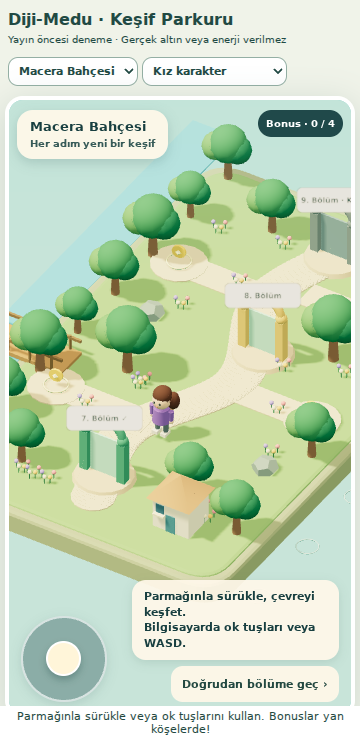
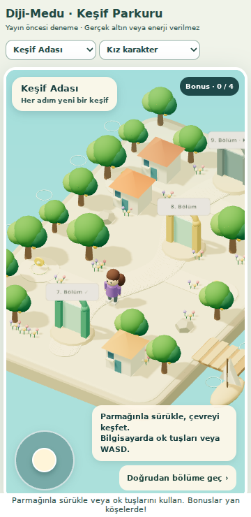

# 3D parkur keşfi — GERİ ALINDI

**Güncel durum: 23 Ekim 2026 tarihinde kullanıcı talebiyle 3D kontrolü geri alındı. Önceki parkur haritası yeniden etkin. İlerleme ve ödül verileri değiştirilmedi.**

Önceki yayın kaydı: PR #170 main'e birleştirildi (`8eb332a`); diji-api sürüm 190 ACTIVE. SQL migration uygulandı. Canlı ön yüz dosyaları HTTP 200; anonim API isteği 401, demo durum isteği 200. Canlı veritabanında tekrar ödül kontrolü transaction içinde doğrulanıp geri alındı; demo cüzdanında test ödülü bırakılmadı.

Geri almak için **“3D parkuru geri al”** demek yeterlidir. [Geri alma kaydı](../deployment/route-exploration-rollback.md), önceki `05ed77d` sürümünü ve korunan dalı içerir. İlerleme ve ödüller korunur.

## Hazırlanan davranış

- Okul Yolum: Macera Bahçesi. Öğrenme Yolum: Keşif Adası. Var olan iki ilerleme motoru ve hesap seçimi kullanılır; yeni ders veya ayrı ilerleme kaydı oluşturulmaz.
- Gerçek WebGL/Three.js sahnesi: 3D zemin, karakter, ağaçlar, yapılar, bölüm kapıları. Konsept çizimleri hedef sanat yönünü gösterir; çalışan sürüm daha sade, stilize 3D modeller kullanır. Çizimlerin birebir 3D kopyası olduğu iddia edilmemeli.
- Parmağı sahnede sürükleyerek veya sol alttaki kumandayla dört yönde yürüme. Bilgisayarda oklar/WASD; bırakınca, odak kaybında ve sekme değişiminde durma.
- Cinsiyet `yo.karakter.cins` değerinden gelir: `k` kız, `e` erkek. Hesapta seçim yoksa nötr keşif karakteri kullanılır; isimden cinsiyet tahmin edilmez. Ten, saç rengi ve desteklenen üst giysi rengi profil seçiminden alınır. Bu sürüm bütün mağaza kıyafetlerini 3D modellemez.
- Oyuncu haritanın kenarlarından düşemez ve ağaç/yapıların içinden geçemez. Son tamamlanan, sıradaki ve sonraki durak görünür. Kapıya yaklaşınca başlatma düğmesi çıkar; kilitli ders başlatılmaz. Tüm duraklara mevcut listeyle erişilir.
- Yol kenarlarında dört ayrı keşif köşesi: 3 × 2 altın, 1 × 1 enerji. Ana yolun üzerinde ödül dizisi yoktur. Bonuslar isteğe bağlıdır; doğrudan bölüme geçiş korunur.
- Bonuslar önceki gerçekten tamamlanmış durağa bağlıdır. İlk bölümden önce ödül yoktur. Sunucu öğrenci oturumunu, aktif hesabı ve gerçek tamamlamayı doğrular; miktar istemciden alınmaz. `(öğrenci, exploration, parkur:durak:bonus)` tekilliği yeniden toplama ve tekrar isteklerini engeller.
- Enerji kapasitesi doluyken enerji bonusu harcanmış sayılmaz. Daha sonra yeniden açıldığında alınabilir. SQL ödül defteri ve cüzdanı tek transaction'da değiştirir.
- Demo hesabında bonuslar görsel denemedir; cüzdan değişmez. Profil/hesap değişiminde eski hesabın geç dönen yanıtı yeni hesaba uygulanmaz.
- 3D açılamazsa mevcut durak haritası çalışır. Three.js 0.180.0 ve lisansı repoya eklenmiştir; CDN yoktur. Modüller parkur açılınca yüklenir, piksel oranı 1.6 ile sınırlıdır, statik çevre InstancedMesh ile gruplanır. Gizli haritada çizim durur; sahne kapanınca GPU kaynakları temizlenir.

## İnceleme

Yerelde `python -m http.server 8080 --directory ingilizce` ile sunup `http://localhost:8080/route-exploration-preview.html` adresini açın. Bu sayfa iki haritayı ve kız/erkek/seçimsiz profilleri gerçek cüzdan işlemi yapmadan gösterir.




## Doğrulama

- Node: 108 test geçti; mevcut başlangıç, ilerleme, iki parkur, tematik öğrenme, üye araçları, kayıt ve API güvenlik testleri ile 6 yeni keşif testi.
- İzole PostgreSQL (PGlite): hazırlanan SQL ve mevcut gerçek `dm_progress_credit` fonksiyonu birlikte çalıştırıldı. Tamamlanmamış durak reddi, altın/enerji tekrar isteği, dolu kapasite ve tekrar deneme, anon/authenticated doğrudan RPC erişim reddi doğrulandı. Production'a sorgu veya migration uygulanmadı.
- Chromium: 360×740, 768×1024, 1440×900; iki harita, cinsiyet değiştirme, klavye/parmak sürükleme, bırakınca durma, doğrudan başlatma, JS hatası ve taşma kontrolü. Gerçek tuşlarla yan köşeye yürüyüp bonus toplama ve sahne yeniden oluşturulunca toplananın gizli kalması kontrol edildi.
- Aynı boyutlarda mevcut parkur CSS'i ve `oyna-v2.js` üzerinden entegrasyon: sahne/denetim sınırları, tıklama engeli olmaması, okul/öğrenme bölüm açma parametreleri kontrol edildi.
- Fiziksel iPhone/iPad Safari ve canlı veritabanı bu hazırlık aşamasında test edilmedi. Yayın öncesi görsel onay çalışan sürümün bu ekran görüntülerine göre alınmalı.

Tekrar çalıştırma:

```sh
node --test tests/start-path.test.cjs tests/progression-api.test.cjs tests/thematic-learning.test.cjs tests/dual-route.test.cjs tests/member-tools.test.cjs tests/api-security-guards.test.cjs tests/onboarding-registration.test.cjs tests/route-exploration.test.mjs
# Playwright/Chromium ve PGlite QA bağımlılıklarını proje dışındaki bir dizine kurun.
# NODE_PATH'i Playwright'ın kurulu olduğu node_modules'a ayarlayın.
node tests/route-exploration-browser.cjs
node tests/route-exploration-integration.cjs
# PGLITE_PATH gerekirse @electric-sql/pglite paketinin mutlak yoludur.
node tests/route-exploration-db.cjs
```

## Yalnızca yayın onayından sonra

1. Güncel main ile dalı karşılaştırın; ilgili testleri tekrar çalıştırın.
2. `deployment/route-exploration.sql` dosyasını hedef Supabase projesine uygulayın (veri sıfırlama yok). Yeni RPC yalnızca service_role'a açıktır.
3. Bu daldaki `diji-api` kaynağını yayınlayın. Başka Edge Function'a gerek yoktur.
4. Hazırlanan ön yüzü main'e birleştirip mevcut site yayın mekanizmasını kullanın. Gerçek öğrenciyle cinsiyet, tek seferlik ödül ve Safari hareket kontrolünü doğrulayın.
5. Geri alma gerekirse ön yüzde `route-exploration.js` ve CSS yüklemesini kaldırın; mevcut durak haritası geri gelir. Ödül defterini silmeyin: tekrar ödül basılmasını önler.
